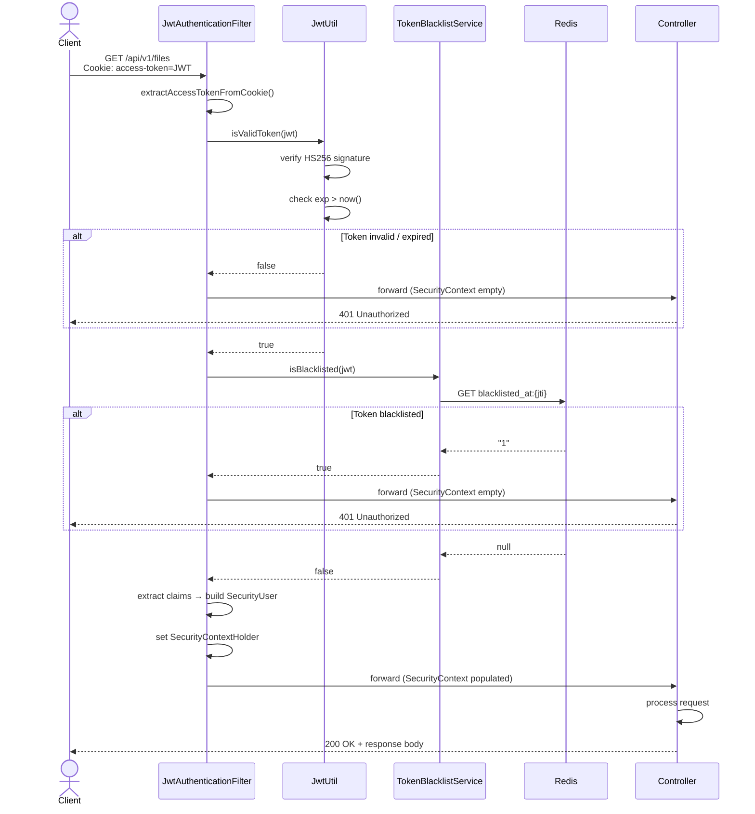
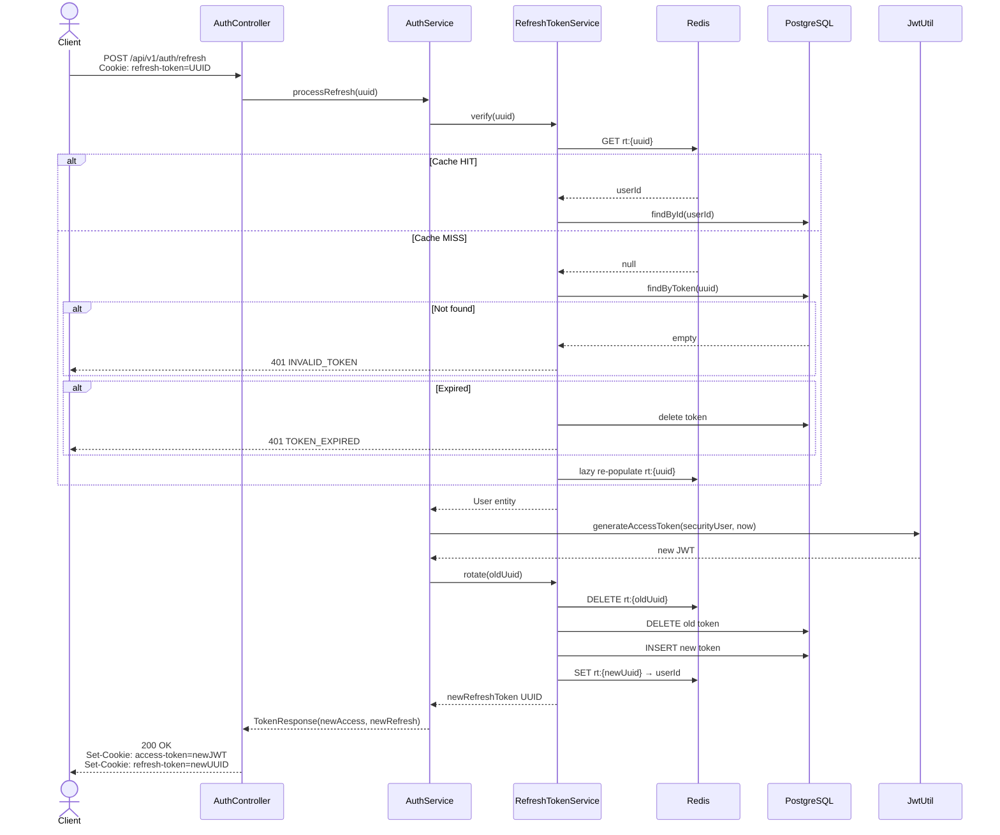
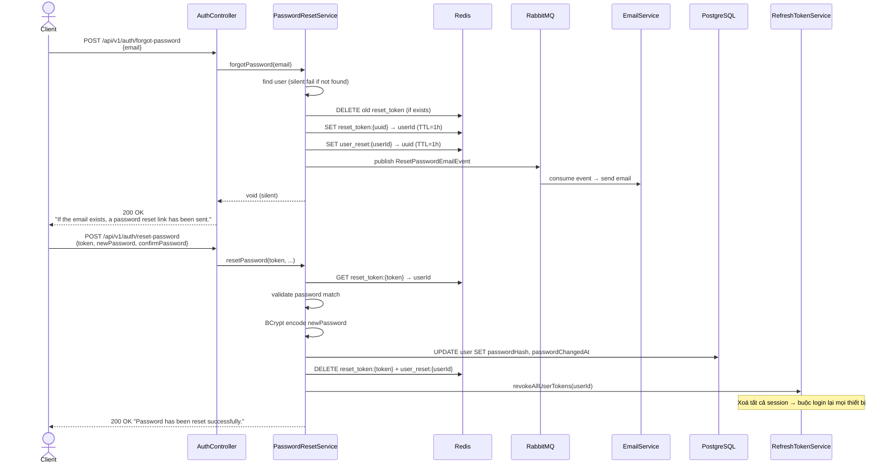

# Security & Authentication Architecture

> **Dành cho:** Developer mới tham gia dự án  
> **Cập nhật lần cuối:** 2026-04-15  
> **Stack:** Spring Boot 4 · Spring Security · JWT (nimbus-jose-jwt HS256) · Redis · PostgreSQL

---

## Mục lục

1. [Tổng quan Security](#1-tổng-quan-security)
2. [Các Component Chính](#2-các-component-chính)
3. [Luồng Authentication Chi Tiết](#3-luồng-authentication-chi-tiết)
   - 3.1 [Đăng nhập (Sign In)](#31-đăng-nhập-sign-in)
   - 3.2 [Refresh Token](#32-refresh-token)
   - 3.3 [Logout](#33-logout)
   - 3.4 [Forgot Password & Reset Password](#34-forgot-password--reset-password)
   - 3.5 [Email Verification](#35-email-verification)
4. [Authorization – Phân quyền](#4-authorization--phân-quyền)
5. [Luồng Request Thực Tế](#5-luồng-request-thực-tế)
6. [Security Rules Quan Trọng](#6-security-rules-quan-trọng)
7. [Sơ Đồ Minh Hoạ](#7-sơ-đồ-minh-hoạ)

---

## 1. Tổng quan Security

### Mô hình bảo mật

Hệ thống sử dụng mô hình **Stateless JWT Authentication** kết hợp **Refresh Token Rotation**:

- **Access Token**: JWT ký bằng HMAC-SHA256, chứa đầy đủ claims nhận diện người dùng. Mỗi request gửi kèm qua **HttpOnly cookie** tên `access-token`.
- **Refresh Token**: UUID ngẫu nhiên, lưu song song ở **Redis** (fast lookup) và **PostgreSQL** (durability). Gửi qua HttpOnly cookie tên `refresh-token`.
- **Không có session phía server** – Spring Security được cấu hình `SessionCreationPolicy.STATELESS`.
- **Không dùng Authorization header** – token đi qua cookie để ngăn XSS đọc được token từ JavaScript.

### Luồng tổng quát

```
Client ──[cookie: access-token]──► JwtAuthenticationFilter ──► SecurityContext ──► Controller
         [cookie: refresh-token]
```

Khi access token hết hạn:

```
Client ──[cookie: refresh-token]──► POST /api/v1/auth/refresh ──► cặp cookie mới
```

---

## 2. Các Component Chính

| Layer | Class / File | Vai trò |
|---|---|---|
| **Infrastructure** | `SecurityConfig` | Cấu hình toàn bộ Spring Security: filter chain, CORS, CSRF, session policy, `PasswordEncoder` |
| **Infrastructure** | `JwtAuthenticationFilter` | Filter chạy mỗi request; đọc cookie → validate JWT → populate `SecurityContext` |
| **Infrastructure** | `JwtUtil` | Sinh token, verify chữ ký + expiry, extract claims (nimbus-jose-jwt HS256) |
| **Infrastructure** | `DelegatedSecurityExceptionHandler` | Chuyển lỗi 401/403 từ Security filter về `GlobalExceptionHandler` để format chuẩn |
| **Infrastructure** | `PasswordConstraint` | Bean Validation annotation kiểm tra độ mạnh mật khẩu |
| **Adapter (inbound)** | `AuthController` | REST endpoints `/api/v1/auth/**` |
| **Adapter (inbound)** | `SecurityUser` | Spring Security principal; mang `userId`, `tenantId`, `role`, `email` |
| **Application** | `AuthService` | Orchestrate sign-in, refresh, logout |
| **Application** | `CustomUserDetailsService` | Load user từ DB để `DaoAuthenticationProvider` verify mật khẩu |
| **Application** | `RefreshTokenService` | Tạo, xác minh, rotate, và invalidate refresh token |
| **Application** | `TokenBlacklistService` | Thêm access token vào Redis blacklist khi logout |
| **Application** | `CookieService` | Tạo / xoá HttpOnly cookie cho access & refresh token |
| **Application** | `PasswordResetService` | Quản lý forgot-password / reset-password flow |
| **Application** | `EmailVerificationService` | Quản lý email verification flow |
| **Adapter (outbound)** | `RefreshTokenRedisCache` | Redis adapter cho refresh token (key schema: `rt:{uuid}` → userId) |
| **Shared** | `SecurityContextUtil` | Helper tĩnh lấy `SecurityUser` hoặc `userId` từ `SecurityContextHolder` |

---

## 3. Luồng Authentication Chi Tiết

### 3.1 Đăng nhập (Sign In)

**Endpoint:** `POST /api/v1/auth/signin`  
**Request body:**
```json
{
  "email": "user@example.com",
  "password": "P@ssw0rd!"
}
```

**Các bước xử lý:**

```
1. AuthController.signIn()
   └─► AuthService.processSignIn()
       │
       ├─ (1) Gọi AuthenticationManager.authenticate()
       │       └─► DaoAuthenticationProvider
       │               ├─ CustomUserDetailsService.loadUserByUsername(email)
       │               │   └─ Query DB: findByEmailWithRoleAndTenant(email)
       │               │   └─ Trả về SecurityUser (có passwordHash, isActive)
       │               └─ BCryptPasswordEncoder.matches(rawPassword, passwordHash)
       │                   ✗ Sai → throw INVALID_CREDENTIALS (401)
       │                   ✓ Đúng → Authentication object
       │
       ├─ (2) Nếu user isActive = false → throw ACCOUNT_DISABLED (403)
       │
       ├─ (3) Load User entity từ DB (cần FK cho RefreshToken)
       │
       ├─ (4) Cập nhật user.lastLoginAt = now()
       │
       ├─ (5) JwtUtil.generateAccessToken(securityUser, now)
       │       └─ Claims: sub=email, userId, tenantId, role, jti=UUID, iat, exp
       │       └─ Ký HMAC-SHA256 với secret key từ config
       │
       ├─ (6) RefreshTokenService.createRefreshToken(user, now)
       │       ├─ Tạo UUID ngẫu nhiên
       │       ├─ Lưu vào PostgreSQL (bảng refresh_tokens)
       │       └─ Lưu vào Redis: rt:{uuid} → userId (TTL = refreshTokenExpirationMs)
       │
       └─ (7) CookieService tạo 2 HttpOnly cookie:
               ├─ access-token  → JWT string, SameSite=Strict, Secure (prod)
               └─ refresh-token → UUID string, SameSite=Strict, Secure (prod)
```

**Response:** HTTP 200, không có body token — token nằm hoàn toàn trong `Set-Cookie` header.

---

### 3.2 Refresh Token

**Endpoint:** `POST /api/v1/auth/refresh`  
**Cookie gửi kèm:** `refresh-token={uuid}`

**Các bước xử lý:**

```
1. AuthController.refresh()
   └─► AuthService.processRefresh(refreshTokenString)
       │
       ├─ (1) RefreshTokenService.verify(refreshTokenString)
       │       ├─ Parse UUID từ string → lỗi format → INVALID_TOKEN (401)
       │       ├─ Tìm trong Redis: rt:{uuid} → userId (cache hit → fast path)
       │       │   └─ Nếu miss → query PostgreSQL
       │       │       ├─ Không tìm thấy → INVALID_TOKEN (401)
       │       │       ├─ Đã hết hạn → xoá DB → TOKEN_EXPIRED (401)
       │       │       └─ Hợp lệ → lazy re-populate Redis
       │       └─ Trả về User entity
       │
       ├─ (2) Build SecurityUser từ User entity
       │
       ├─ (3) JwtUtil.generateAccessToken() → access token mới
       │
       └─ (4) RefreshTokenService.rotate(refreshTokenString)
               ├─ Xoá token cũ khỏi Redis + PostgreSQL
               └─ Tạo token mới → lưu Redis + PostgreSQL
               └─ Trả về token UUID mới (replay-attack prevention)
```

> **Tại sao rotate?** Nếu refresh token bị đánh cắp, attacker dùng token → token cũ bị xoá → victim refresh lần tiếp sẽ nhận lỗi và phát hiện compromise.

---

### 3.3 Logout

**Endpoint:** `POST /api/v1/auth/logout`  
**Cookie gửi kèm:** `refresh-token={uuid}`, `access-token={jwt}`  
**Public endpoint** (không cần JWT hợp lệ — access token có thể đã hết hạn).

**Các bước xử lý:**

```
1. AuthController.logout()
   └─► AuthService.logout(refreshToken, accessToken)
       │
       ├─ (1) RefreshTokenService.invalidate(refreshTokenString)
       │       ├─ Tìm userId từ Redis → xoá rt:{uuid} + user_rt:{userId} member
       │       └─ Xoá record trong PostgreSQL
       │
       ├─ (2) TokenBlacklistService.blacklist(accessToken)
       │       ├─ Parse JTI (jwtID) từ access token
       │       ├─ Tính TTL còn lại của token
       │       └─ Lưu Redis: blacklisted_at:{jti} = "1" (TTL = remaining lifetime)
       │           → Token tự hết hạn trong Redis, không cần clean up thủ công
       │
       └─ (3) SecurityContextHolder.clearContext()

2. CookieService tạo 2 expired cookie (maxAge=0) → browser xoá cookie
```

> **Fail-open strategy:** Nếu Redis không khả dụng khi check blacklist, hệ thống cho phép request đi qua (thay vì block toàn bộ traffic). Access token sẽ tự hết hạn tự nhiên theo TTL.

---

### 3.4 Forgot Password & Reset Password

**Bước 1 – Yêu cầu reset:**

**Endpoint:** `POST /api/v1/auth/forgot-password`  
**Body:** `{ "email": "user@example.com" }`

```
PasswordResetService.forgotPassword(email)
│
├─ (1) Tìm user theo email (lowercase + trim)
│       └─ Không tìm thấy hoặc inactive → return (im lặng — ngăn email enumeration)
│
├─ (2) Nếu có reset token cũ → xoá khỏi Redis
│
├─ (3) Tạo UUID ngẫu nhiên → lưu Redis:
│       ├─ reset_token:{uuid} → userId  (TTL = 1 giờ)
│       └─ user_reset:{userId} → uuid   (TTL = 1 giờ, ngăn nhiều token song song)
│
└─ (4) Publish event qua RabbitMQ → Email service gửi link:
        {frontendUrl}/reset-password?token={uuid}
```

**Bước 2 – Xác minh token (tuỳ chọn, FE có thể dùng trước khi show form):**

**Endpoint:** `POST /api/v1/auth/verify-reset-token?token={uuid}`

```
PasswordResetService.validateResetToken(token)
└─ Tìm key reset_token:{token} trong Redis
    └─ Không có → RESET_TOKEN_INVALID (400)
```

**Bước 3 – Đặt mật khẩu mới:**

**Endpoint:** `POST /api/v1/auth/reset-password`  
**Body:** `{ "token": "...", "newPassword": "...", "confirmPassword": "..." }`

```
PasswordResetService.resetPassword(token, newPassword, confirmPassword)
│
├─ (1) Validate token trong Redis → không có → RESET_TOKEN_INVALID
├─ (2) Kiểm tra newPassword == confirmPassword → không khớp → PASSWORD_MISMATCH
├─ (3) Load user, kiểm tra isActive
├─ (4) BCrypt encode mật khẩu mới → cập nhật user.passwordHash + user.passwordChangedAt
├─ (5) Xoá reset token khỏi Redis
└─ (6) RefreshTokenService.revokeAllUserTokens(userId)
        └─ Xoá tất cả refresh token của user (Redis + DB) → buộc đăng nhập lại mọi thiết bị
```

---

### 3.5 Email Verification

Khi admin tạo user mới, tài khoản có `isActive = false`. User cần verify email để kích hoạt.

**Gửi email verification:**

```
EmailVerificationService.sendVerificationEmail(user)
├─ Xoá token cũ nếu có
├─ Tạo UUID → lưu Redis:
│   ├─ verify_email:{uuid} → userId  (TTL = 24 giờ)
│   └─ user_verify:{userId} → uuid   (TTL = 24 giờ)
└─ Publish event → RabbitMQ → Email service gửi link:
    {frontendUrl}/verify-email?token={uuid}
```

**Xác minh:**

**Endpoint:** `GET /api/v1/auth/verify-email?token={uuid}`

```
EmailVerificationService.verifyEmail(token)
├─ Tìm token trong Redis
├─ Load user
├─ Nếu đã active → clean up Redis, return (idempotent)
├─ Đặt user.isActive = true → lưu DB
└─ Xoá token khỏi Redis
```

**Resend:**

**Endpoint:** `POST /api/v1/auth/resend-verification`  
Body: `{ "email": "..." }` → gọi lại `sendVerificationEmail` (im lặng nếu không tìm thấy hoặc đã active).

---

## 4. Authorization – Phân quyền

### Hệ thống Role

Hệ thống có 3 role được định nghĩa trong `RoleCode` enum:

| Role | Mô tả |
|------|--------|
| `SUPER_ADMIN` | Quản trị viên hệ thống, quyền cao nhất |
| `TENANT_ADMIN` | Quản trị viên của một tenant (tổ chức) |
| `MEMBER` | Thành viên thường của tenant |

Role được lưu trong bảng `roles` (PostgreSQL) và tham chiếu từ bảng `users`.

### Role trong JWT

Khi generate access token, `role` được nhúng trực tiếp vào JWT claims:

```java
// JwtUtil.generateAccessToken()
.claim("role", securityUser.getRole())  // vd: "TENANT_ADMIN"
```

Khi `JwtAuthenticationFilter` xử lý request, nó extract `role` từ claims và tạo `SecurityUser` với `GrantedAuthority`:

```java
// SecurityUser.getAuthorities()
return List.of(new SimpleGrantedAuthority("ROLE_" + role));
// → "ROLE_TENANT_ADMIN", "ROLE_MEMBER", ...
```

### Cách kiểm tra quyền

Hệ thống dùng `@EnableMethodSecurity` (kích hoạt trong `SecurityConfig`) nên có thể dùng `@PreAuthorize` trực tiếp trên method:

```java
// Ví dụ trên Controller hoặc Service
@PreAuthorize("hasRole('SUPER_ADMIN')")
public void deleteAllTenants() { ... }

@PreAuthorize("hasAnyRole('TENANT_ADMIN', 'SUPER_ADMIN')")
public void inviteUser() { ... }

@PreAuthorize("hasRole('MEMBER')")
public void uploadFile() { ... }
```

### Multi-Tenancy trong Authorization

Mỗi request mang `tenantId` từ JWT claims. **Mọi truy vấn database đều phải filter theo `tenantId`** để đảm bảo tenant isolation:

```java
// Lấy tenantId từ SecurityContext
SecurityUser user = SecurityContextUtil.getCurrentUser().orElseThrow(...);
String tenantId = user.getTenantId(); // từ JWT claims

// Dùng trong repository
fileRepository.findByIdAndTenantId(fileId, tenantId); // KHÔNG được bỏ tenantId!
```

> **Quy tắc bắt buộc:** Không bao giờ dùng `ThreadLocal` hay global tenant context. `tenantId` phải được truyền tường minh qua từng lớp.

### Lấy thông tin user hiện tại

```java
// Lấy SecurityUser (Optional)
Optional<SecurityUser> user = SecurityContextUtil.getCurrentUser();

// Lấy UUID (throw nếu chưa authenticate)
UUID userId = SecurityContextUtil.getCurrentUserUuidOrThrow(); // throw ACCESS_DENIED nếu không có
```

---

## 5. Luồng Request Thực Tế

Dưới đây là hành trình của một **authenticated request** (ví dụ: `GET /api/v1/files`) qua hệ thống:

```
Client
  │
  │  GET /api/v1/files
  │  Cookie: access-token=eyJhbGciOiJIUzI1NiJ9...
  │
  ▼
[Spring Security Filter Chain]
  │
  ├─ Step 1: CorsFilter
  │          Kiểm tra Origin, Method, Headers theo CorsConfiguration
  │          → OPTIONS preflight: trả 200 ngay
  │
  ├─ Step 2: JwtAuthenticationFilter (OncePerRequestFilter)
  │          │
  │          ├─ Đọc cookie "access-token" từ HttpServletRequest
  │          │   └─ Không có cookie → SecurityContext trống → tiếp tục chain
  │          │
  │          ├─ JwtUtil.isValidToken(token)
  │          │   ├─ Parse JWT (nimbus-jose-jwt)
  │          │   ├─ Verify HMAC-SHA256 signature
  │          │   └─ Kiểm tra exp > now()
  │          │       ✗ Hết hạn / sai chữ ký → skip (context trống)
  │          │
  │          ├─ TokenBlacklistService.isBlacklisted(token)
  │          │   └─ Tìm key "blacklisted_at:{jti}" trong Redis
  │          │       ✗ Tìm thấy → skip (context trống)
  │          │
  │          └─ Nếu token hợp lệ + không blacklisted:
  │              ├─ Extract claims: userId, tenantId, role, email
  │              ├─ Tạo SecurityUser(userId, tenantId, role, email)
  │              └─ Set SecurityContextHolder.Authentication (KHÔNG query DB!)
  │
  ├─ Step 3: AuthorizationFilter
  │          Kiểm tra SecurityContext vs. authorization rules:
  │          ├─ Public endpoint (/api/v1/auth/**) → permitAll → OK
  │          └─ Protected endpoint:
  │              ├─ SecurityContext có Authentication → OK
  │              └─ SecurityContext trống → throw AuthenticationException → 401
  │
  ▼
[DispatcherServlet → Controller]
  │
  ├─ Step 4: @PreAuthorize kiểm tra (nếu có annotation)
  │          ├─ user.getAuthorities() chứa required role → OK
  │          └─ Thiếu quyền → AccessDeniedException → 403
  │
  ├─ Step 5: Controller xử lý request
  │          SecurityContextUtil.getCurrentUserUuidOrThrow() lấy userId
  │
  └─ Step 6: Response trả về client


[Nếu có lỗi Security (401/403)]
  │
  └─ DelegatedSecurityExceptionHandler
      └─ Delegate sang HandlerExceptionResolver
          └─ GlobalExceptionHandler.handleGlobalException()
              └─ Trả về JSON chuẩn: { "code": 2, "message": "Access Denied" }
```

---

## 6. Security Rules Quan Trọng

### 6.1 Public vs Protected Endpoints

| Endpoint | Access | Lý do |
|----------|--------|-------|
| `POST /api/v1/auth/signin` | Public | Chưa có token |
| `POST /api/v1/auth/refresh` | Public | Access token có thể đã hết hạn |
| `POST /api/v1/auth/logout` | **Public** | Client gọi khi access token hết hạn; token cleanup vẫn xảy ra qua refresh token |
| `POST /api/v1/auth/forgot-password` | Public | Unauthenticated user |
| `POST /api/v1/auth/verify-reset-token` | Public | Dùng link từ email |
| `POST /api/v1/auth/reset-password` | Public | Dùng link từ email |
| `GET /api/v1/auth/verify-email` | Public | Dùng link từ email |
| `POST /api/v1/auth/resend-verification` | Public | User chưa verify |
| `GET /api/v1/auth/me` | **Protected** | Cần biết ai đang hỏi |
| `GET /api/v1/files/**` | **Protected** | Cần xác thực + tenant |
| `/swagger-ui/**`, `/v3/api-docs/**` | Public | Dev tools |
| `/actuator/**` | Public | Health check, monitoring |

Tất cả các endpoint không nằm trong danh sách public đều **tự động yêu cầu xác thực** (`anyRequest().authenticated()`).

### 6.2 CSRF

**CSRF bị tắt** (`AbstractHttpConfigurer::disable`) vì:
- Hệ thống Stateless – không có session
- Token nằm trong `HttpOnly` cookie không thể bị đọc bởi JavaScript
- `SameSite=Strict` trên cookie ngăn cross-site request mang cookie theo

### 6.3 CORS

```yaml
Allowed Origins:  * (tất cả, nhưng kết hợp credentials=true → browser chỉ cho phép exact origins)
Allowed Methods:  GET, POST, PUT, PATCH, DELETE, OPTIONS
Allow Credentials: true  ← bắt buộc để browser gửi cookie cross-origin
Allowed Headers:  *
Exposed Headers:  X-XSRF-TOKEN
```

> **Lưu ý production:** `allowedOriginPatterns("*")` kết hợp `allowCredentials(true)` hoạt động đúng theo CORS spec — browser sẽ chỉ gửi cookie khi origin khớp với `Access-Control-Allow-Origin` trong response.

### 6.4 Password Encoding

Mật khẩu được hash bằng **BCrypt** (`BCryptPasswordEncoder`) trước khi lưu DB:

```java
user.setPasswordHash(passwordEncoder.encode(rawPassword)); // khi tạo/reset
```

**Không bao giờ** lưu mật khẩu plaintext. BCrypt tự động thêm salt ngẫu nhiên, mỗi lần encode cho kết quả khác nhau (nhưng `matches()` vẫn đúng).

### 6.5 Password Policy

Được enforce qua annotation `@PasswordConstraint` (Bean Validation):

```
Regex: ^(?=.*\d)(?=.*[A-Z])(?=.*[a-z])(?=.*[^\w\s:])(\\S){8,16}$

Yêu cầu:
  ✓ 8 đến 16 ký tự
  ✓ Ít nhất 1 chữ HOA (A-Z)
  ✓ Ít nhất 1 chữ thường (a-z)
  ✓ Ít nhất 1 chữ số (0-9)
  ✓ Ít nhất 1 ký tự đặc biệt (!@#$%...)
  ✗ Không có khoảng trắng
```

Annotation này được dùng ở `SignInRequest` và `ResetPasswordRequest`.

### 6.6 Cookie Security

| Thuộc tính | Giá trị | Mục đích |
|-----------|---------|---------|
| `HttpOnly` | `true` | Ngăn JavaScript đọc token (chống XSS) |
| `Secure` | `false` (dev) / `true` (prod) | Chỉ gửi qua HTTPS |
| `SameSite` | `Strict` | Ngăn gửi cookie trong cross-site request (chống CSRF) |
| `Path` | `/` | Gửi cùng mọi request đến server |
| `MaxAge` | access: từ config / refresh: từ config | Tự hết hạn |

### 6.7 Redis Key Schema (tóm tắt)

| Key | Value | TTL | Mục đích |
|-----|-------|-----|---------|
| `rt:{tokenUuid}` | userId | Thời gian còn lại của refresh token | Lookup refresh token nhanh |
| `user_rt:{userId}` | Set\<tokenUuid\> | 2× refresh TTL | Revoke tất cả session của user |
| `blacklisted_at:{jti}` | `"1"` | Thời gian còn lại của access token | Blacklist access token sau logout |
| `reset_token:{uuid}` | userId | 1 giờ | Password reset flow |
| `user_reset:{userId}` | uuid | 1 giờ | Ngăn nhiều reset token song song |
| `verify_email:{uuid}` | userId | 24 giờ | Email verification |
| `user_verify:{userId}` | uuid | 24 giờ | Ngăn nhiều verify token song song |

### 6.8 JWT Claims

```json
{
  "sub": "user@example.com",       // email (subject)
  "userId": "550e8400-...",         // UUID của user
  "tenantId": "6ba7b810-...",       // UUID của tenant
  "role": "TENANT_ADMIN",           // RoleCode (SUPER_ADMIN | TENANT_ADMIN | MEMBER)
  "jti": "f47ac10b-...",            // JWT ID (dùng cho blacklist)
  "iat": 1744700000,                // issued at (epoch seconds)
  "exp": 1744703600                 // expiration (epoch seconds)
}
```

---

## 7. Sơ Đồ Minh Hoạ

### 7.1 Login Flow (Sequence Diagram)

```mermaid
sequenceDiagram
    actor Client
    participant AuthController
    participant AuthService
    participant AuthManager as DaoAuthenticationProvider
    participant UDS as CustomUserDetailsService
    participant JwtUtil
    participant RefreshTokenService
    participant Redis
    participant PostgreSQL

    Client->>AuthController: POST /api/v1/auth/signin<br/>{email, password}
    AuthController->>AuthService: processSignIn(request)
    AuthService->>AuthManager: authenticate(email, rawPassword)
    AuthManager->>UDS: loadUserByUsername(email)
    UDS->>PostgreSQL: findByEmailWithRoleAndTenant(email)
    PostgreSQL-->>UDS: User entity
    UDS-->>AuthManager: SecurityUser (với passwordHash)
    AuthManager->>AuthManager: BCrypt.matches(rawPassword, hash)
    alt Credentials invalid
        AuthManager-->>AuthService: throw AuthenticationException
        AuthService-->>Client: 401 INVALID_CREDENTIALS
    end
    AuthManager-->>AuthService: Authentication (SecurityUser)
    AuthService->>PostgreSQL: update lastLoginAt
    AuthService->>JwtUtil: generateAccessToken(securityUser, now)
    JwtUtil-->>AuthService: JWT string (HS256)
    AuthService->>RefreshTokenService: createRefreshToken(user, now)
    RefreshTokenService->>PostgreSQL: INSERT refresh_tokens
    RefreshTokenService->>Redis: SET rt:{uuid} → userId (TTL)
    RefreshTokenService-->>AuthService: refreshToken UUID
    AuthService-->>AuthController: TokenResponse(accessToken, refreshToken)
    AuthController->>Client: 200 OK<br/>Set-Cookie: access-token=JWT; HttpOnly; SameSite=Strict<br/>Set-Cookie: refresh-token=UUID; HttpOnly; SameSite=Strict
```

---

### 7.2 Authenticated Request Flow



---

### 7.3 Refresh Token Flow



---

### 7.4 Logout Flow

```mermaid
sequenceDiagram
    actor Client
    participant AuthController
    participant AuthService
    participant RefreshTokenService
    participant Blacklist as TokenBlacklistService
    participant Redis
    participant PostgreSQL

    Client->>AuthController: POST /api/v1/auth/logout<br/>Cookie: access-token=JWT<br/>Cookie: refresh-token=UUID
    AuthController->>AuthService: logout(refreshToken, accessToken)
    AuthService->>RefreshTokenService: invalidate(refreshToken)
    RefreshTokenService->>Redis: GET user_rt lookup → DELETE rt:{uuid}
    RefreshTokenService->>PostgreSQL: DELETE FROM refresh_tokens WHERE token=uuid
    AuthService->>Blacklist: blacklist(accessToken)
    Blacklist->>Blacklist: parse JTI + calculate remaining TTL
    Blacklist->>Redis: SET blacklisted_at:{jti} = "1" (TTL = remaining)
    AuthService->>AuthService: SecurityContextHolder.clearContext()
    AuthController->>Client: 200 OK<br/>Set-Cookie: access-token=; MaxAge=0<br/>Set-Cookie: refresh-token=; MaxAge=0
    Note over Client: Browser xoá cả 2 cookie
```

---

### 7.5 Forgot Password Flow



---

## Quick Reference

### Cấu hình token (application-dev.yml)

```yaml
app:
  security:
    jwt:
      secret: ${JWT_SECRET_KEY}                           # Base64-encoded HMAC-SHA256 key
      accessTokenExpirationMs: ${JWT_ACCESS_TOKEN_EXPIRATION:3600}      # ~1 giờ
      refreshTokenExpirationMs: ${JWT_REFRESH_TOKEN_EXPIRATION:604800}  # ~7 ngày
    securedCookie: false           # true trong production (bắt buộc HTTPS)
    resetTokenExpirationMs: 3600000        # 1 giờ
    emailVerificationExpirationMs: 86400000 # 24 giờ
```

### Checklist bảo mật khi thêm endpoint mới

- [ ] Endpoint có cần xác thực không? Nếu không → thêm vào `PUBLIC_ENDPOINTS` trong `SecurityConfig`
- [ ] Endpoint cần role cụ thể không? → Thêm `@PreAuthorize("hasRole('...')")`
- [ ] Query DB có filter theo `tenantId` chưa?
- [ ] Không trả về thông tin nhạy cảm (password hash, internal IDs của tenant khác)
- [ ] Input validation với `@Valid` + Bean Validation constraints

### Các lỗi Security phổ biến

| ErrorCode | HTTP | Tình huống |
|-----------|------|-----------|
| `INVALID_CREDENTIALS` (1000) | 401 | Sai email/password khi login |
| `TOKEN_EXPIRED` (1002) | 401 | Refresh token hết hạn |
| `INVALID_TOKEN` (1003) | 401 | Token không tồn tại / đã logout |
| `USER_NOT_FOUND` (1004) | 404 | userId trong JWT không còn trong DB |
| `ACCOUNT_DISABLED` (1010) | 403 | User chưa verify email hoặc bị khoá |
| `RESET_TOKEN_INVALID` (1011) | 400 | Token reset password hết hạn / không tồn tại |
| `ACCESS_DENIED` (2) | 401 | Request tới protected endpoint không có JWT |

